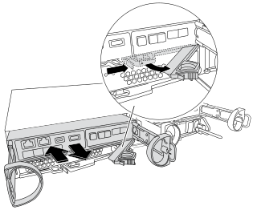

= Substitua o chassi no seu sistema FAS2820
:allow-uri-read: 
:icons: font
:imagesdir: ../media/

[role="lead"]
No seu sistema FAS2820, mova as fontes de alimentação, os discos rígidos e o(s) módulo(s) controlador(es) do chassi com problema para o chassi de substituição e troque o chassi com problema do rack de equipamentos ou gabinete do sistema pelo chassi de substituição do mesmo modelo do chassi com problema.

[[step-1-move-a-power-supply]]
== Passo 1: Mova uma fonte de alimentação

A remoção de uma fonte de alimentação ao substituir um chassi envolve desligar, desconetar e remover a fonte de alimentação do chassi com deficiência e instalá-la e conectá-la no chassi de substituição.

. Se você ainda não está aterrado, aterre-se adequadamente.
. Desligue a fonte de alimentação e desligue os cabos de alimentação:
+
.. Desligue o interrutor de alimentação da fonte de alimentação.
.. Abra o retentor do cabo de alimentação e, em seguida, desligue o cabo de alimentação da fonte de alimentação.
.. Desconete o cabo de alimentação da fonte de alimentação.

. Aperte o trinco na pega do excêntrico da fonte de alimentação e, em seguida, abra a pega do excêntrico para libertar totalmente a fonte de alimentação do plano intermédio.
. Utilize a pega do came para fazer deslizar a fonte de alimentação para fora do sistema.
+

CAUTION: Ao remover uma fonte de alimentação, utilize sempre duas mãos para suportar o seu peso.

. Repita as etapas anteriores para qualquer fonte de alimentação restante.
. Apoie e alinhe as bordas da fonte de alimentação com a abertura no chassi usando ambas as mãos e, em seguida, empurre suavemente a fonte de alimentação para dentro do chassi usando a alça de came.
+
As fontes de alimentação são chaveadas e só podem ser instaladas de uma forma.

+

NOTE: Não utilize força excessiva ao deslizar a fonte de alimentação para o sistema. Pode danificar o conetor.

. Feche a pega do excêntrico de forma a que o trinco encaixe na posição de bloqueio e a fonte de alimentação fique totalmente assente.
. Volte a ligar o cabo de alimentação e fixe-o à fonte de alimentação utilizando o mecanismo de bloqueio do cabo de alimentação.
+

NOTE: Ligue apenas o cabo de alimentação à fonte de alimentação. Não ligue o cabo de alimentação a uma fonte de alimentação neste momento.

[[step-2-remove-the-controller-module]]
== Passo 2: Remova o módulo do controlador

Retire o módulo do controlador ou os módulos do chassis danificado.

. Solte o gancho e a alça de loop que prendem os cabos ao dispositivo de gerenciamento de cabos e, em seguida, desconete os cabos do sistema e os SFPs (se necessário) do módulo do controlador, mantendo o controle de onde os cabos estavam conetados.
+
Deixe os cabos no dispositivo de gerenciamento de cabos para que, ao reinstalar o dispositivo de gerenciamento de cabos, os cabos sejam organizados.

. Retire e reserve os dispositivos de gerenciamento de cabos dos lados esquerdo e direito do módulo do controlador.
. Aperte o trinco na pega do excêntrico até que este se solte, abra totalmente o manípulo do excêntrico para libertar o módulo do controlador do plano médio e, em seguida, utilizando duas mãos, puxe o módulo do controlador para fora do chassis.
+

. Coloque o módulo do controlador de lado num local seguro.
. Repita estes passos para o segundo módulo do controlador no chassis.

[[step-3-move-drives-to-the-replacement-chassis]]
== Etapa 3: Mova as unidades para o chassi de substituição

Mova as unidades de cada abertura do compartimento de unidade no chassi com deficiência para a mesma abertura do compartimento no chassi de substituição.

. Retire cuidadosamente a moldura da parte frontal do sistema.
. Remova as unidades:
+
.. Prima o botão de libertação no lado oposto dos LEDs.
.. Puxe o manípulo do excêntrico para a posição totalmente aberta para retirar a transmissão do plano médio e, em seguida, deslize cuidadosamente a unidade para fora do chassis.
+
A transmissão deve desengatar-se do chassis, permitindo que deslize para fora do chassis.

+

NOTE: Ao remover uma unidade, utilize sempre duas mãos para suportar o seu peso.

+

NOTE: Os acionamentos são frágeis. Manuseie-os o mínimo possível para evitar danos.

. Alinhe a unidade do chassi com a mesma abertura do compartimento no chassi de substituição.
. Empurre cuidadosamente a unidade para dentro do chassis o mais longe possível.
+
O manípulo do excêntrico engata e começa a rodar para a posição fechada.

. Empurre firmemente a unidade o resto do caminho para dentro do chassis e, em seguida, bloqueie a pega do excêntrico empurrando-a contra o suporte da unidade.
+
Certifique-se de que fecha lentamente o manípulo do excêntrico de forma a que fique corretamente alinhado com a parte dianteira do suporte da transmissão. Ele clica quando é seguro.

. Repita o processo para as unidades restantes no sistema.

[[step-4-replace-a-chassis-from-within-the-equipment-rack-or-system-cabinet]]
== Etapa 4: Substitua um chassi de dentro do rack de equipamentos ou do gabinete do sistema

Remova o chassi existente do rack de equipamentos ou do gabinete do sistema e instale o chassi de substituição no rack de equipamentos ou no gabinete do sistema.

. Retire os parafusos dos pontos de montagem do chassis.
. Com a ajuda de duas ou três pessoas, deslize o chassi danificado para fora dos trilhos do rack em um gabinete de sistema ou dos suportes em L em um rack de equipamentos e, em seguida, coloque-o de lado.
. Se você ainda não está aterrado, aterre-se adequadamente.
. Instale o chassi de substituição no rack ou gabinete do sistema com a ajuda de duas ou três pessoas, guiando o chassi sobre os trilhos do rack em um gabinete de sistema ou sobre os suportes em L em um rack.
. Deslize o chassi até o rack de equipamentos ou o gabinete do sistema.
. Fixe a parte frontal do chassis ao rack de equipamentos ou ao gabinete do sistema, usando os parafusos que você removeu do chassi danificado.
. Se ainda não o tiver feito, instale a moldura.

[[step-5-install-the-controller]]
== Passo 5: Instale o controlador

Instale o módulo controlador e quaisquer outros componentes no chassi de substituição e, em seguida, inicialize-o no modo de manutenção.

Para pares de HA com dois módulos de controlador no mesmo chassi, a sequência em que você instala o módulo de controlador é especialmente importante porque ele tenta reiniciar assim que você o senta completamente no chassi.

. Alinhe a extremidade do módulo do controlador com a abertura no chassis e, em seguida, empurre cuidadosamente o módulo do controlador até meio do sistema.
+

NOTE: Não introduza completamente o módulo do controlador no chassis até ser instruído a fazê-lo.

. Recable o console para o módulo do controlador e, em seguida, reconete a porta de gerenciamento.
. Repita os passos anteriores para o segundo controlador no chassis de substituição.
. Conclua a instalação do módulo do controlador:
+
.. Com a alavanca do came na posição aberta, empurre firmemente o módulo do controlador até que ele atenda ao plano médio e esteja totalmente assentado e, em seguida, feche a alavanca do came para a posição travada.
+

NOTE: Não utilize força excessiva ao deslizar o módulo do controlador para dentro do chassis para evitar danificar os conetores.

.. Se ainda não o tiver feito, reinstale o dispositivo de gerenciamento de cabos.
.. Prenda os cabos ao dispositivo de gerenciamento de cabos com o gancho e a alça de loop.
.. Repita os passos anteriores para o segundo módulo do controlador no chassis de substituição.

. Ligue as fontes de alimentação a diferentes fontes de alimentação e, em seguida, ligue-as.
. Inicialize cada controlador para o modo de manutenção:
+
.. Assim que cada controlador começar a inicializar, pressione  `Ctrl-C` para interromper o processo de inicialização quando vir a mensagem  `Press Ctrl-C for Boot Menu`.
+

NOTE: Se você perder o prompt e os módulos do controlador iniciarem no ONTAP, digite `halt` e, em seguida, no prompt Loader ENTER `boot_ontap`, pressione `Ctrl-C` quando solicitado e, em seguida, repita esta etapa.

.. No menu de arranque, selecione a opção para o modo de manutenção.

