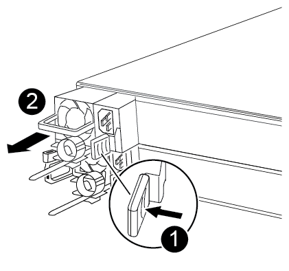

= Substitua a fonte de alimentação no seu sistema FAS500f em funcionamento.
:allow-uri-read: 
:icons: font
:imagesdir: ../media/

[role="lead"]
A substituição de uma fonte de alimentação envolve desconetar a fonte de alimentação de destino (PSU) da fonte de alimentação, desconetar o cabo de alimentação, remover a fonte de alimentação antiga e instalar a fonte de alimentação de substituição e conectá-la novamente à fonte de alimentação.

* As fontes de alimentação são redundantes e hot-swap.
* Este procedimento é escrito para substituir uma fonte de alimentação de cada vez.
+

NOTE: É uma prática recomendada substituir a fonte de alimentação dentro de dois minutos após a remoção do chassi. O sistema continua a funcionar, mas o ONTAP envia mensagens ao console sobre a fonte de alimentação degradada até que a fonte de alimentação seja substituída.

Você pode usar o vídeo a seguir ou as etapas tabuladas para substituir a fonte de alimentação:

.Animação - substitua a fonte de alimentação
video::86487f5e-20ff-43e6-99ae-ac5b015c1aa5[panopto]
. Se você ainda não está aterrado, aterre-se adequadamente.
. Identifique a fonte de alimentação que pretende substituir, com base em mensagens de erro da consola ou através do LED vermelho de avaria na fonte de alimentação.
. Desligue a fonte de alimentação:
+
.. Abra o retentor do cabo de alimentação e, em seguida, desligue o cabo de alimentação da fonte de alimentação.
.. Desconete o cabo de alimentação da fonte de alimentação.

. Gire a alavanca de came para puxar a fonte de alimentação para fora do módulo controlador enquanto pressiona a trava de segurança.
+
[CAUTION]
====
A fonte de alimentação é curta. Utilize sempre as duas mãos para o apoiar quando o retirar do módulo do controlador, de modo a que não se liberte subitamente do módulo do controlador e o machuque.

====
+

+
|===

 a| 
image:../media/icon_round_1.png["Legenda número 1"]
| Patilha de bloqueio da fonte de alimentação azul 

 a| 
image:../media/icon_round_2.png["Legenda número 2"]
 a| 
Fonte de alimentação

|===
. Utilizando ambas as mãos, apoie e alinhe as extremidades da fonte de alimentação com a abertura no módulo do controlador e, em seguida, empurre cuidadosamente a fonte de alimentação para o módulo do controlador até que a patilha de bloqueio encaixe no lugar.
+
As fontes de alimentação se encaixam no conector interno e travam no lugar de apenas uma maneira.

+

NOTE: Para evitar danificar o conetor interno, não utilize força excessiva ao deslizar a fonte de alimentação para o sistema.

. Reconecte o cabeamento da fonte de alimentação:
+
.. Volte a ligar o cabo de alimentação à fonte de alimentação e à fonte de alimentação.
.. Fixe o cabo de alimentação à fonte de alimentação utilizando o retentor do cabo de alimentação.

+
Após o restabelecimento da energia na fonte de alimentação, o LED indicador de status deve ficar verde.

. Devolva a peça com falha ao NetApp, conforme descrito nas instruções de RMA fornecidas com o kit. Consulte a https://mysupport.netapp.com/site/info/rma["Devolução de peças e substituições"^] página para obter mais informações.

