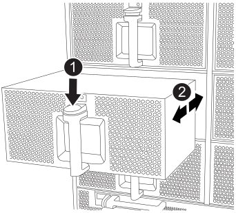

= Troque a quente um módulo de ventoinha em um sistema FAS9500
:allow-uri-read: 
:icons: font
:imagesdir: ../media/

[role="lead"]
Para substituir a quente um módulo de ventoinha no seu FAS9500 sem interromper o serviço, você deve executar uma sequência específica de tarefas.

IMPORTANT: É uma boa prática substituir o módulo de ventoinha em até dois minutos após removê-lo do chassi. O sistema continua funcionando, mas o ONTAP envia mensagens ao console sobre o módulo de ventoinha degradado até que o módulo de ventoinha seja substituído.

.Passos
. Se você ainda não está aterrado, aterre-se adequadamente.
. Retire a moldura (se necessário) com duas mãos, segurando as aberturas de cada lado da moldura e puxando-a na sua direção até que a moldura se solte dos pernos esféricos na estrutura do chassis.
. Identifique o módulo da ventoinha que deve substituir verificando as mensagens de erro da consola e observando o LED de atenção em cada módulo da ventoinha.
. Prima o botão terra cotta no módulo da ventoinha e puxe o módulo da ventoinha para fora do chassis, certificando-se de que o apoia com a mão livre.
+

IMPORTANT: Os módulos da ventoinha são curtos. Apoie sempre a parte inferior do módulo da ventoinha com a mão livre para que não caia subitamente do chassis e o machuque.

+
.Animação - Remover/instalar a ventoinha
video::86b0ed39-1083-4b3a-9e9c-ae78004c2ffc[panopto]
+

+
[cols="20%,80%"]
|===

 a| 
image::../media/icon_round_1.png[Legenda número 1]
 a| 
Botão de liberação terra cotta

 a| 
image::../media/icon_round_2.png[Legenda número 2]
 a| 
Deslize o ventilador para dentro/fora do chassi

|===
. Coloque o módulo da ventoinha de lado.
. Alinhe as extremidades do módulo do ventilador de substituição com a abertura no chassi e, em seguida, deslize-o para dentro do chassi até que ele se encaixe no lugar.
+
Quando inserido num sistema ativo, o LED âmbar de atenção pisca quatro vezes quando o módulo da ventoinha é inserido com sucesso no chassis.

. Alinhe a moldura com os pernos esféricos e, em seguida, empurre cuidadosamente a moldura para os pernos esféricos.
. Devolva a peça com falha ao NetApp, conforme descrito nas instruções de RMA fornecidas com o kit. Consulte a https://mysupport.netapp.com/site/info/rma["Devolução de peças e substituições"^] página para obter mais informações.

